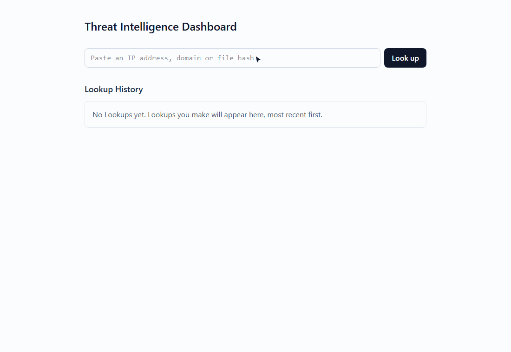
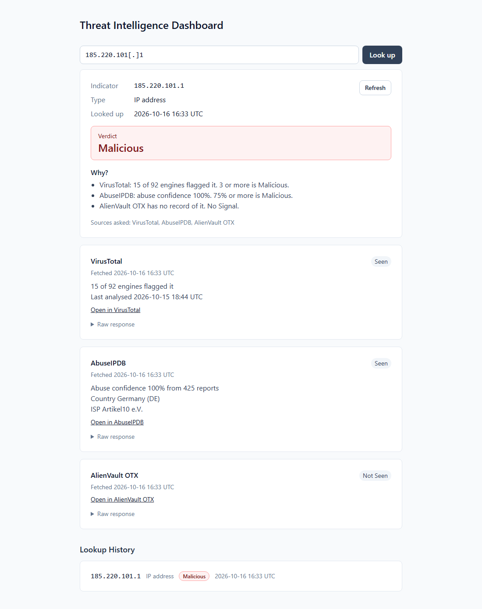
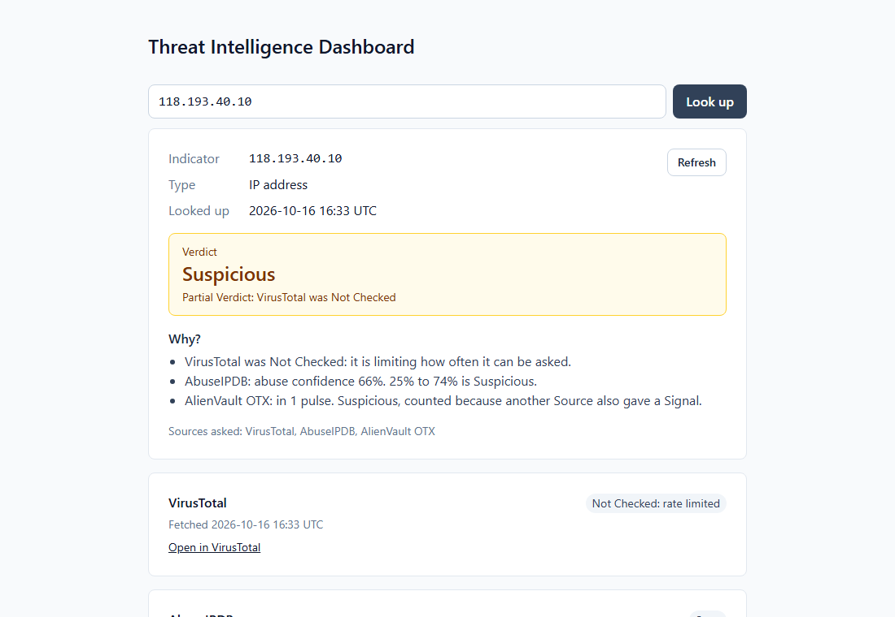
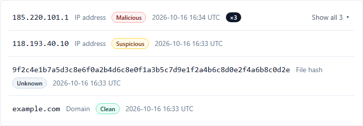
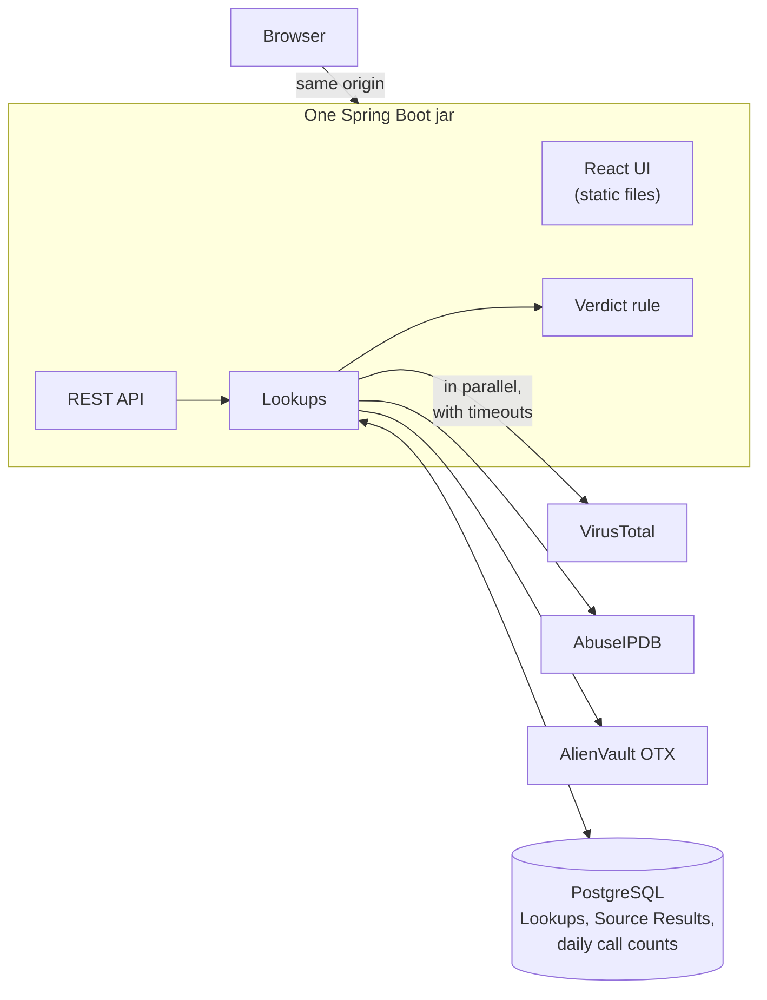

# Threat Intelligence Dashboard

A SOC analyst triaging an alert usually has one question about a suspicious IP address, domain or file hash: is it bad? Answering it means pasting the value into VirusTotal, AbuseIPDB and AlienVault OTX one tab at a time and reconciling three different reports. This dashboard asks all three at once and combines their answers into one Verdict (Malicious, Suspicious, Clean or Unknown). It shows the reasoning behind the Verdict and keeps every Lookup in a history you can reopen exactly as it was. It runs locally with one `docker compose up`.



<sub>The demo and screenshots run against recorded VirusTotal, AbuseIPDB and OTX responses (see [Test](#test)), so they can be regenerated with `npm run demo`.</sub>

## Features

- **One box for any Indicator.** Paste an IP address (v4 or v6), domain or MD5/SHA-1/SHA-256 hash. Its type is worked out for you, and defanged values like `185.220.101[.]1` or `evil[.]com` are refanged. Private and reserved IP addresses, URLs and anything unrecognised are rejected, and the message says why.
- **One Verdict with its reasoning.** Malicious, Suspicious, Clean or Unknown, with a "Why?" list showing each Source's reading and the threshold it crossed.
- **A panel per Source.** The facts that matter (engines flagging it, abuse confidence, country, ISP, pulses), a link to the Source's own page and the raw response.
- **Sources asked in parallel**, each with a timeout. A Source that is rate-limited, down, out of quota or missing its API key is shown as **Not Checked**, never as clean, and the Verdict is marked **Partial** with the Sources it lacks.
- **Lookup History.** Most recent first, with repeat Lookups of an Indicator grouped. Any past Lookup reopens as it was, with a banner when newer Source Results exist.
- **Gentle on free API quotas.** Recent Source Results (24 hours by default) are reused instead of asking the Source again, and **Refresh** asks again on demand. Each Source stops being asked at 90% of its daily quota.

| A Lookup | A Partial Verdict | Lookup History |
| --- | --- | --- |
| [](docs/images/lookup.png) | [](docs/images/partial-verdict.png) | [](docs/images/lookup-history.png) |

## How it works



- **A single deployable.** Maven builds the React app into the Spring Boot jar, so one container serves the UI and the API from the same origin, with no CORS and no tokens. Why: [ADR 0001](docs/adr/0001-single-deployable-react-inside-spring-boot.md).
- **Sources.** Each Source covers certain Indicator Types and is asked only about those (AbuseIPDB covers IP addresses only). A Source Result is never changed. Asking again creates a new one, which is what lets a past Lookup reopen exactly as it was.
- **The Verdict rule** is deliberately simple and visible to the Analyst:
  - Each Source Result gives a Signal: Malicious, Suspicious or none. VirusTotal gives Malicious at 3+ flagging engines and Suspicious at 1+. AbuseIPDB gives Malicious at 75%+ abuse confidence and Suspicious at 25%+. OTX gives Suspicious when a pulse mentions the Indicator. The thresholds are configurable in `.env`.
  - The worst counted Signal wins.
  - OTX is a **Corroborating Source**: its Signal counts only when another Source also gives a Signal, because anyone can write a pulse.
  - With no counted Signal, the Verdict is **Clean** if any Source has seen the Indicator, and **Unknown** if none has.

The design was worked out before the code. The domain language is in [`CONTEXT.md`](CONTEXT.md), and the architecture decisions are in [`docs/adr/`](docs/adr/).

## Run it

Needs [Docker Desktop](https://www.docker.com/products/docker-desktop/) installed and **running**.

1. **Get free API keys.** Each Source works without the others; one without a key is shown as Not Checked.
   - **VirusTotal:** sign up at [virustotal.com](https://www.virustotal.com/gui/join-us), then open your avatar menu → **API key**. The free public API allows 4 requests a minute and 500 a day.
   - **AbuseIPDB:** sign up at [abuseipdb.com](https://www.abuseipdb.com/register), then go to **Account → API** and create a key. The free plan allows 1,000 checks a day.
   - **AlienVault OTX:** sign up at [otx.alienvault.com](https://otx.alienvault.com/), then open **Settings**. Your **OTX Key** is shown there.
2. **Set up `.env`** (it is git-ignored, so your keys stay out of the repo):

   ```sh
   cp .env.example .env
   ```

   Then paste each key after its `=`: `VIRUSTOTAL_API_KEY`, `ABUSEIPDB_API_KEY`, `OTX_API_KEY`. The file also lists the optional settings: Verdict thresholds, Source timeout, reuse window and daily quotas.
3. **Start it:**

   ```sh
   docker compose up
   ```

   Open http://localhost:8080. The database schema is created on start-up. After pulling new code, run `docker compose up --build` to rebuild the app.

## Known limitations

- **A file hash's Verdict rests on VirusTotal.** Only VirusTotal and OTX cover file hashes, and OTX is a Corroborating Source, so a hash gets a Malicious or Suspicious Verdict only when VirusTotal gives a Signal.
- **VirusTotal's free tier allows 4 requests a minute.** Several fresh Lookups in quick succession can come back with VirusTotal **Not Checked (rate limited)** and a Partial Verdict. Wait a minute and press **Refresh**.
- **Local and single-Analyst.** There is no sign-in, and the Lookup History belongs to whoever runs it.

## Next: the Hosted milestone

The local-first MVP is done. The next milestone puts it online. That means hosting (Oracle Cloud Always Free is the leading candidate), deployment from CI and HTTPS. It also means GitHub sign-in for multiple Analysts, each with a private Lookup History, a daily Lookup Allowance and "Delete my history".

## Tech stack

- **Backend:** Spring Boot 3, Java 21, PostgreSQL, Flyway
- **Frontend:** React, TypeScript, Vite, Tailwind CSS
- **Tests:** JUnit 5, AssertJ, Testcontainers and WireMock (backend); Vitest, React Testing Library and MSW (frontend); Playwright (smoke test)
- **Delivery:** Docker Compose, GitHub Actions running all three test suites on every push

## Develop

Needs Java 21 and Node 22.12+ (see `frontend/.nvmrc`). Maven comes with the wrapper.

```sh
docker compose up db          # PostgreSQL only
./mvnw spring-boot:run        # API on http://localhost:8080
cd frontend && npm ci && npm run dev   # UI with hot reload on http://localhost:5173, proxies /api
```

## Test

```sh
./mvnw verify                 # backend tests; Testcontainers needs Docker running
cd frontend && npm test       # frontend tests
cd e2e && npm ci && npx playwright install chromium && npm test   # smoke test; needs Docker running
```

The smoke test builds the app's Docker image and starts it with its own PostgreSQL and with WireMock standing in for every Source ([`e2e/compose.yaml`](e2e/compose.yaml)). Then it makes a Lookup in a real browser. The fake Sources serve real responses recorded from each API (`src/test/resources/wiremock/__files`), the same ones the backend tests use. `npm run demo` in `e2e/` runs a scripted tour against that stack and re-records the GIF and screenshots above.

## License

[MIT](LICENSE)
